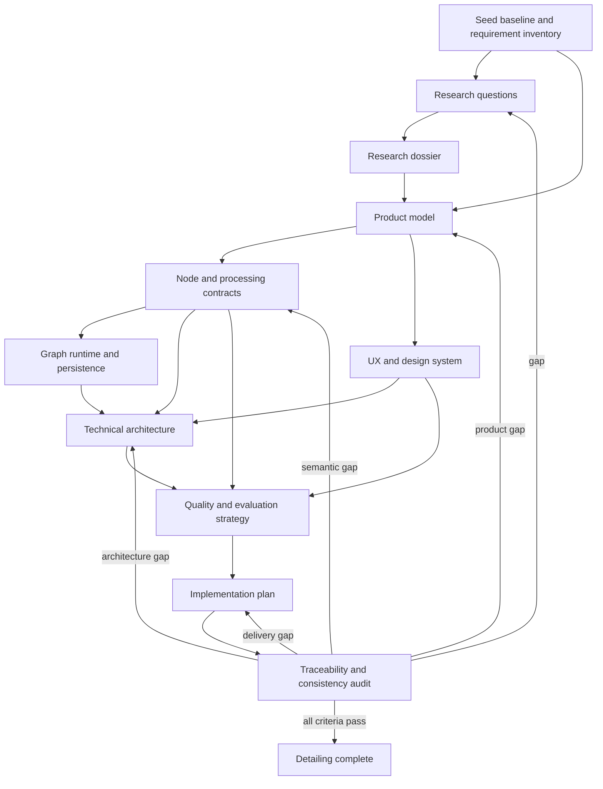

# Detailing Plan

## 1. Purpose

This plan defines how the seed concept will be converted into a complete,
implementation-ready product specification and implementation plan. It is a
plan for producing those documents; it is not the implementation plan itself.

The source of truth is `seed-spec.md`. That file is an immutable human-authored
reference. Ambiguities found while detailing it must be resolved in derived
documents and recorded as decisions, assumptions, or open questions. They must
not be resolved by editing the seed.

The work follows `agent-graph-loop.md`: each workstream has an outcome,
observable definition of done, required evidence, an evaluator, and a bounded
loop that reopens the smallest incomplete workstream.

## 2. Overall Outcome

Produce a coherent specification set from which an engineering team can build,
test, ship, and maintain the 2D texture-map composition web application without
inventing material product behavior during implementation.

### Project definition of done

The detailing project is done when all of the following are true:

1. Every seed requirement maps to at least one normative requirement and one
   verification method.
2. Product boundaries, personas, jobs, workflows, terminology, defaults, and
   failure behavior are explicit.
3. Every node has defined ports, accepted data types, parameters, defaults,
   processing semantics, preview behavior, serialization, and edge cases.
4. Image and mask semantics cover alpha, transfer functions, color spaces,
   bit depth, dimensions, orientation, normal conventions, and precision.
5. Blend and modifier behavior is mathematically or normatively defined rather
   than described only by UI labels.
6. Graph behavior covers editing, validation, cycles, evaluation, caching,
   cancellation, persistence, recovery, import, export, and compatibility.
7. The UX and design-system specification covers all principal workflows,
   interaction states, keyboard access, responsive constraints, light/dark
   themes, and the custom HSL picker.
8. Security, privacy, accessibility, performance, reliability, browser support,
   observability, and release constraints have measurable acceptance criteria.
9. Architecture decisions identify ownership boundaries and include rejected
   alternatives and tradeoffs where the choice is consequential.
10. The implementation plan is ordered by dependencies, closes vertical slices,
    and gives every milestone objective exit criteria and required evidence.
11. A traceability matrix has no orphan seed statements, requirements, tests,
    risks, or implementation milestones.
12. Independent consistency and feasibility reviews have no unresolved blocking
    findings.

## 3. Constraints and Non-Goals of Detailing

- Preserve the seed verbatim.
- This phase produces specifications and plans, not production application code.
- Do not assume 3D rendering. Normal, bump, displacement, roughness, and lighting
  exist only to produce a 2D raster result.
- Do not equate normal, height, roughness, and displacement data internally merely
  because the product exposes them as interchangeable creative modifiers. Their
  ingestion and standardization rules must preserve meaningful distinctions.
- Prefer deterministic, local-first processing. Any proposed network dependency
  must have an explicit user benefit, privacy analysis, and offline behavior.
- Separate normative requirements (`must`) from recommendations (`should`),
  options (`may`), assumptions, and unresolved decisions.
- Use stable requirement IDs throughout all derived documents.

## 4. Deliverable Set

| ID | Deliverable | Outcome |
| --- | --- | --- |
| D01 | Detailing plan | Defines the work graph, loops, evidence, and closure criteria. |
| D02 | Research dossier | Answers defined research questions using authoritative sources and records implications. |
| D03 | Product requirements | Defines scope, users, workflows, terminology, functional requirements, and acceptance criteria. |
| D04 | Node and image-processing specification | Defines types, node contracts, formulas, blend modes, modifiers, color handling, and exports. |
| D05 | Graph runtime and persistence specification | Defines evaluation, state, schemas, history, IndexedDB, workflow files, and PNG metadata. |
| D06 | UX and design-system specification | Defines information architecture, interactions, accessibility, themes, components, and HSL picker behavior. |
| D07 | Technical architecture | Defines modules, workers, compute backends, boundaries, performance budgets, security, and deployment. |
| D08 | Quality and evaluation strategy | Defines unit, conformance, visual, integration, performance, security, recovery, and compatibility evidence. |
| D09 | Implementation plan | Defines dependency-ordered vertical slices, milestone exit criteria, rollout, and resourcing assumptions. |
| D10 | Traceability and decision registers | Proves coverage and records assumptions, risks, open questions, and architecture decisions. |

## 5. Outcome Graph



The graph is dependency-aware rather than purely sequential. Research may proceed
in parallel by topic. Product, processing, UX, and architecture outcomes may be
developed incrementally, but dependent documents cannot close before their input
decisions close.

## 6. Workstreams and Loops

### W01: Seed baseline and vocabulary

**Outcome:** Convert every seed statement into a uniquely addressable inventory
without changing its intent.

**Tasks**

- Assign source IDs to seed statements in a traceability register.
- Build a glossary for image, mask, material, modifier, map, layer, light, port,
  node state, workflow snapshot, and export artifact.
- Separate explicit requirements from examples, inferred requirements, and
  ambiguities.
- Record contradictions and terms that need normative definitions.

**Evidence and evaluator**

- Evidence: seed-to-requirement inventory and glossary.
- Evaluation: every actionable seed bullet is represented exactly once as a source
  statement and may map to multiple downstream requirements.

**Exit condition:** zero unclassified actionable seed statements.

**Reopen when:** a later workstream discovers an unmodeled interpretation or a
term is used inconsistently.

### W02: Research

**Outcome:** Produce decision-relevant evidence for the product and architecture,
not a collection of links or feature comparisons.

**Research tracks**

1. Browser image decode/encode support, EXIF orientation, ICC profiles, alpha,
   HDR and wide-gamut handling, and TIFF constraints.
2. Color models and operations: linear-light versus encoded RGB, HSL limitations,
   temperature/tint, luminance, exposure, tone controls, and perceptual color
   difference.
3. W3C/PDF/industry blend-mode definitions, compositing order, premultiplied
   alpha, clipping, and compatibility semantics.
4. Normal-map conventions, tangent channel orientation, height-to-normal
   conversion, roughness/height interpretation, directional-light equations,
   and robust preprocessing of arbitrary images.
5. Resampling filters, quality/performance tradeoffs, alpha-aware resizing,
   edge behavior, and deterministic reference implementations.
6. React Flow capabilities and limits for node state, handles, resizing,
   keyboard controls, accessibility, minimaps, save/restore, and large graphs.
7. Web workers, OffscreenCanvas, WebAssembly SIMD/threads, WebGPU, browser memory
   limits, tiling, scheduling, cancellation, and fallback architecture.
8. IndexedDB durability, quota/eviction, origin-private storage, autosave,
   migrations, corruption recovery, and multi-tab coordination.
9. PNG ancillary chunks, metadata size limits, integrity, stripping by other
   software, safe workflow embedding, and sidecar fallback.
10. Client-side PNG/JPEG/TIFF export libraries, licensing, maintenance,
    determinism, metadata behavior, and maximum image dimensions.
11. Comparable node editors and raster tools, focusing on workflow principles,
    portability, failure recovery, and user expectations rather than feature
    checklists.
12. WCAG and ARIA requirements for graph editors, custom color controls, canvas
    content, keyboard navigation, focus, contrast, and non-color alternatives.
13. Security threats in untrusted image and JSON parsing, decompression bombs,
    malformed metadata, object URLs, dependency supply chain, and exported data.

**Source standard**

- Prefer standards, browser documentation, framework maintainers, peer-reviewed
  papers, and maintained library documentation.
- Record source title, publisher, URL, access date, applicable claim, confidence,
  caveat, and product implication.
- Use secondary sources only to discover primary evidence or document real-world
  interoperability behavior absent from primary sources.
- Time-sensitive support claims must include an access date and target browser
  versions.

**Evidence and evaluator**

- Evidence: question-led research notes, source matrix, benchmark fixtures, and
  architecture implications.
- Evaluation: every research question has an answer, confidence, and a concrete
  decision or identified experiment. A comparison without an extracted design
  principle does not pass.

**Exit condition:** no high-impact decision depends solely on an unsupported
assumption; unresolved items have a named prototype or benchmark.

**Reopen when:** implementation planning exposes a decision without evidence or
a selected dependency fails licensing, maintenance, capability, or benchmark
criteria.

### W03: Product requirements

**Outcome:** Define observable product behavior and scope for complete user jobs.

**Tasks**

- Define target users, jobs, usage contexts, supported platforms, and explicit
  non-goals.
- Define project creation, image import, graph authoring, preview, comparison,
  autosave/recovery, workflow interchange, and final export journeys.
- Specify all global and node-level commands, selection rules, shortcuts, menus,
  status feedback, destructive confirmations, and error recovery.
- Distinguish bypass, mute, lock, disable, and invalid states.
- Define requirements with IDs, priority, rationale, acceptance criteria, and
  dependencies.
- Define defaults and first-run behavior.

**Evidence and evaluator**

- Evidence: scenario walkthroughs and requirement acceptance examples.
- Evaluation: each principal job reaches a useful result, including error and
  recovery paths, without relying on unspecified UI or processing behavior.

**Exit condition:** all P0/P1 scenarios have unambiguous Given/When/Then acceptance
criteria and no blocking product questions.

### W04: Node and image-processing contracts

**Outcome:** Make every graph computation deterministic, typed, testable, and
portable across compute backends.

**Tasks**

- Define canonical raster, mask, color, normal, height, light, and material types.
- Define dimensions, bounds, coordinate systems, channel ranges, alpha model,
  transfer functions, color spaces, bit depth, and invalid-value behavior.
- Specify each node's inputs, outputs, controls, defaults, validation, algorithm,
  serialization, cache key, progress, warnings, and failure state.
- Normatively enumerate blend modes and formulas or standards references.
- Specify resize filter names and exact edge/alpha behavior.
- Define normal-map detection/override/normalization and arbitrary-image fallback.
- Define height conversion, light aggregation, material shading, opacity, and
  layer-order semantics.
- Define representative-color calculation and HSL plus perceptual target deltas.
- Define preview scaling and PNG/JPEG/TIFF export semantics.

**Evidence and evaluator**

- Evidence: golden image fixtures, numeric vectors, algorithm pseudocode, and
  cross-backend conformance tolerances.
- Evaluation: independent implementations can produce equivalent outputs within
  stated tolerances from the same serialized workflow and source assets.

**Exit condition:** every node contract has complete normal, boundary, invalid,
and cancellation cases, plus at least one objective oracle.

### W05: Graph runtime, state, and persistence

**Outcome:** Define a reproducible, crash-resilient graph system whose stored
state recreates the same workflow and result.

**Tasks**

- Define port compatibility, edge rules, fan-out, optional/multiple inputs,
  cycle prevention, invalid subgraphs, and topological evaluation.
- Define dirty propagation, cache identity, scheduling, worker messaging,
  priorities, progressive preview, cancellation, and stale-result rejection.
- Define command/history semantics for graph and parameter edits.
- Define canonical project and workflow JSON schemas, versions, IDs, asset
  references, node bounds, z-order, viewport, selection-independent state,
  migrations, validation, and forward-compatibility behavior.
- Define IndexedDB stores, transactions, autosave debounce/checkpoints, quota,
  persistent-storage requests, recovery, deletion, and multi-tab ownership.
- Define portable workflow packaging and PNG metadata embedding with size,
  integrity, schema, and absent/stripped/corrupt metadata handling.

**Evidence and evaluator**

- Evidence: schemas, state-transition tables, save/restore round trips, crash
  simulations, migration fixtures, and deterministic graph tests.
- Evaluation: reopening a project restores authored state exactly and recomputes
  equivalent outputs; partial writes and stale worker results cannot corrupt it.

**Exit condition:** persistence and runtime state machines have no unspecified
transition reachable by a P0/P1 workflow.

### W06: UX and design system

**Outcome:** Define an efficient, accessible node-authoring experience that can
scale in graph and image complexity.

**Tasks**

- Define workspace regions, hierarchy, node library, canvas, inspector, preview,
  toolbar, minimap, status/progress, dialogs, and notifications.
- Define node anatomy, port placement, resize constraints, visual states, level of
  detail by zoom, selection, focus, lock, bypass, mute, invalid, stale, computing,
  and error states.
- Define pointer, touchpad, mouse, and keyboard interaction contracts, including
  conflict-free shortcuts and platform conventions.
- Define custom HSL picker anatomy and behavior against the approved design source;
  maintain a requirements-level fallback until that source is available.
- Define design tokens, typography, spacing, color, elevation, iconography, motion,
  density, themes, contrast, and high-contrast/forced-color behavior.
- Define responsive minimum viewport and constrained-window behavior.
- Define accessible graph alternatives, focus order, labels, announcements, target
  size, non-color encoding, and reduced-motion behavior.

**Evidence and evaluator**

- Evidence: state matrices, interaction tables, keyboard walkthroughs, component
  inventory, token contract, responsive layouts, and accessibility checks.
- Evaluation: every P0/P1 journey is operable with pointer and keyboard; every
  state is distinguishable and has defined feedback.

**Exit condition:** no workflow depends on hover, color, precision pointing, or an
undocumented gesture alone.

### W07: Technical architecture and non-functional requirements

**Outcome:** Select an architecture that satisfies correctness and user latency
under realistic image and graph loads.

**Tasks**

- Define UI, domain, graph runtime, storage, codec, compute, preview, export, and
  platform-adapter boundaries.
- Decide the canonical CPU implementation and optional accelerated backend only
  after conformance and workload benchmarks.
- Keep image processing off the UI thread and avoid persistence or graph-wide
  validation in direct-manipulation hot paths.
- Establish workload tiers and budgets for interaction latency, preview latency,
  full-resolution evaluation, memory, autosave, startup, and export.
- Define tile/halo processing, memory accounting, concurrency caps, cancellation,
  backpressure, and out-of-memory behavior.
- Define browser matrix, feature detection, fallback, bundling, dependency policy,
  update strategy, deployment headers, telemetry boundaries, and offline behavior.
- Complete privacy and threat models.

**Evidence and evaluator**

- Evidence: architecture decision records, prototypes, benchmarks, threat model,
  privacy data-flow map, dependency assessment, and failure-mode analysis.
- Evaluation: selected architecture meets budgets on reference devices and no
  critical path depends on an unsupported or unbounded browser capability.

**Exit condition:** all consequential choices have evidence, owners, fallbacks,
and objective review criteria.

### W08: Quality and evaluation strategy

**Outcome:** Define evidence that proves the product claims at every layer.

**Tasks**

- Map requirements to unit, property, conformance, integration, end-to-end,
  accessibility, visual, performance, security, recovery, and compatibility tests.
- Define non-degenerate fixtures that distinguish blend modes, filter kernels,
  alpha semantics, light directions, normal conventions, and color operations.
- Define cross-backend image comparison metrics and tolerances.
- Define raw execution and DOM/artifact capture separately from pass/fail detectors.
- Define test browser/device matrix, deterministic settings, seed control, and
  golden-update governance.
- Define release gates and defect severity.

**Evidence and evaluator**

- Evidence: test matrix, fixture catalog, oracle definitions, release checklist,
  and example failure artifacts.
- Evaluation: every normative requirement has a credible verification method and
  every named algorithm is proven behaviorally distinct where it should be.

**Exit condition:** zero P0/P1 requirements lack verification; performance and
recovery claims use realistic repeated workflows rather than isolated smoke tests.

### W09: Implementation planning

**Outcome:** Produce an executable delivery plan after product and technical
contracts are stable.

**Tasks**

- Order work by dependency and uncertainty retirement.
- Start with technical spikes only for decisions whose evidence is still missing.
- Define thin vertical slices that include UI, graph contract, compute, persistence,
  and automated evidence where applicable.
- Give each milestone outcome, scope, non-scope, dependencies, tasks, risks,
  objective exit criteria, and required artifacts.
- Include schema migration, fixture generation, observability, documentation,
  packaging, accessibility, hardening, and release work.
- Identify parallelizable work and integration checkpoints without assuming team
  size or calendar duration.

**Evidence and evaluator**

- Evidence: dependency graph, milestone backlog, critical path, risk burn-down,
  and milestone acceptance matrix.
- Evaluation: completing milestones in order yields demonstrable product value and
  closes all P0/P1 requirements without a final integration-only phase.

**Exit condition:** every implementation item contributes to a requirement or
enabler, has prerequisites, and has an objective completion signal.

### W10: Consolidation and audit

**Outcome:** Prove that the document set is complete, consistent, feasible, and
traceable as a whole.

**Audits**

- Seed coverage: source statement to requirement.
- Forward traceability: requirement to design decision, milestone, and test.
- Reverse traceability: implementation/test item to requirement or enabler.
- Contract consistency: names, defaults, types, formulas, states, and shortcuts.
- Cross-cutting consistency: accessibility, security, privacy, performance,
  persistence, and errors across every feature.
- Feasibility: browser capability, memory bounds, codecs, licensing, and fallbacks.
- Decision completeness: no hidden implementation choice with product impact.
- Language: normative and informative statements are distinguishable.

**Evidence and evaluator**

- Evidence: completed matrices, link check, lint results, contradiction report,
  risk register, and explicit open-question disposition.
- Evaluation: each project-level definition-of-done criterion has direct evidence.

**Exit condition:** no blocking gaps, contradictions, orphan records, or unowned
high risks. Non-blocking open questions have owners and decision deadlines tied to
milestones.

## 7. Agent Roles and Skills

Roles are capability boundaries; one agent may perform several roles, but the
author and evaluator should use separate passes and criteria.

| Role | Responsibilities | Useful capabilities |
| --- | --- | --- |
| Orchestrator | Maintain outcome state, dependencies, traceability, and smallest-loop reopening. | Planning, requirements management, consistency checks |
| Product analyst | Convert jobs and seed intent into testable requirements and defaults. | Product specification, workflow analysis, acceptance criteria |
| Imaging researcher | Establish color, compositing, filtering, normal/height, codec, and export semantics. | Standards research, numerical image processing |
| Browser architect | Validate workers, WASM/WebGPU, memory, storage, and browser support. | Prototyping, benchmarking, compatibility research |
| Graph architect | Define typed ports, evaluation, cache, cancellation, and persistence state. | DAG systems, state machines, schema design |
| UX designer | Define node workflows, component states, HSL picker, and responsive behavior. | Interaction design, design systems, usability evaluation |
| Accessibility reviewer | Evaluate graph and custom controls beyond nominal ARIA coverage. | WCAG, keyboard testing, assistive technology |
| Security/privacy reviewer | Threat-model untrusted files, dependencies, local data, and exports. | Threat modeling, parser hardening, privacy review |
| Test architect | Build semantic oracles, fixtures, captures, and release gates. | Property testing, visual/image comparison, E2E testing |
| Delivery planner | Convert closed contracts into dependency-ordered vertical slices. | Estimation inputs, risk sequencing, milestone design |
| Independent auditor | Challenge completeness, contradictions, feasibility, and evidence. | Traceability audit, adversarial review |

Specialized tools should be used where they improve evidence quality: browser
automation for interaction and paint checks, accessibility tooling for automated
and manual audits, image-diff and numeric scripts for algorithm conformance,
profilers for time and memory, schema validators for persistence, and dependency
scanners for licensing and vulnerabilities. Tool output is evidence, not by itself
a product-level pass.

## 8. Decision and Escalation Policy

Every unresolved item is classified as one of:

- **Decision:** alternatives are understood; an authorized choice is needed.
- **Research gap:** evidence can resolve it.
- **Prototype gap:** feasibility or performance must be measured.
- **Design-source dependency:** behavior or visual fidelity needs an unavailable
  source, such as the referenced HSL picker design.
- **Product assumption:** a reversible default can keep detailing moving.
- **Blocker:** proceeding would make downstream contracts unreliable.

Use reversible, explicitly recorded defaults for non-blocking assumptions. Escalate
only choices with material product, compatibility, privacy, cost, or schedule
impact. Each escalation must state options, evidence, recommendation, consequence
of delay, and the last milestone at which the decision remains reversible.

## 9. Risk-Led Detailing Order

The highest-risk questions are answered before detailed UI polish or delivery
estimation:

1. Canonical pixel/color/alpha representation and compositing semantics.
2. Browser decode/encode coverage, especially TIFF output and metadata.
3. Realistic memory and latency for large images and branched graphs.
4. Deterministic CPU baseline and feasibility of accelerated backends.
5. Workflow asset portability and PNG-embedded workflow limits.
6. Normal/height standardization and lighting semantics.
7. Graph persistence, migration, recovery, and multi-tab ownership.
8. Accessible node-editor and custom color-picker interaction.

A failed feasibility check reopens only the specifications that depend on it. For
example, failure of browser-native TIFF encoding reopens the codec architecture and
export requirements, not unrelated node UX.

## 10. Progress State Template

Each workstream reports:

```text
Goal:
Definition of done:
Current state:
Evidence:
Outstanding gaps:
Next action:
Loop level:
Exit condition:
Reopen trigger:
```

States are `not-started`, `in-progress`, `evaluation`, `blocked`, or `closed`.
`closed` requires evidence against every criterion; completing listed activities
is insufficient.

## 11. Final Review Questions

The project-level evaluator must answer yes to all of these:

1. Can a product reviewer predict all P0/P1 observable behavior?
2. Can two independent engineers implement equivalent node outputs?
3. Can a designer produce every principal screen and state without inventing a
   missing interaction?
4. Can QA derive fixtures and objective oracles for every normative requirement?
5. Can an architect bound memory, latency, storage, and failure behavior for each
   supported workload tier?
6. Can a security/privacy reviewer enumerate all persisted, imported, exported,
   and transmitted data?
7. Can a delivery lead order implementation without discovering foundational
   decisions inside late milestones?
8. Does every lower-level outcome demonstrably contribute to the overall outcome?

If any answer is no, the evaluator identifies the smallest responsible workstream,
records the missing evidence, reopens that loop, and reruns consolidation after the
repair.