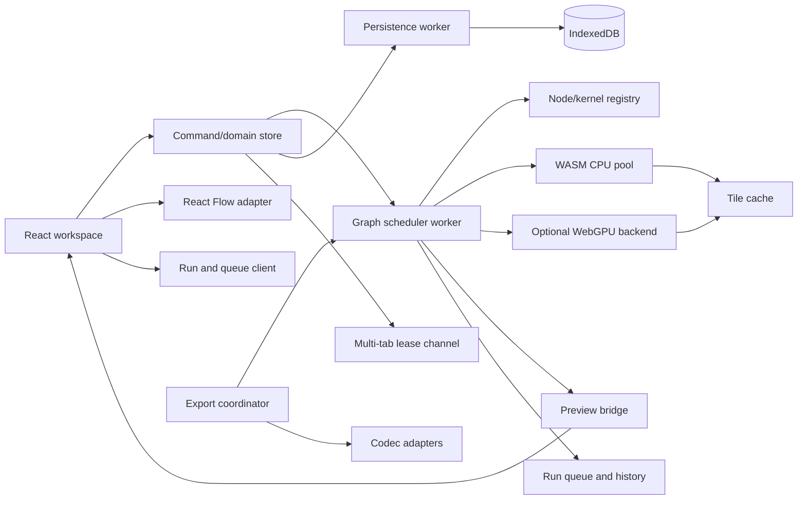

# Technical Architecture, Runtime, and Persistence

## 1. Architecture Outcome

Build a local-first, deterministic image graph that keeps interaction responsive,
contains memory, survives interruption, and reproduces authored output across
supported browsers. React Flow owns graph presentation and interaction; it does
not own image evaluation, domain rules, persistence schema, or workflow format.

## 2. Selected Stack

| Concern | Selection | Rationale |
| --- | --- | --- |
| Language | TypeScript strict mode | Shared contracts across UI, workers, schemas, and tests |
| UI | React + `@xyflow/react` | Seed requirement and maintained node interaction/accessibility surface |
| Build | Vite | Worker/WASM support, development speed, static deployment |
| Authoring state | Zustand with selector subscriptions | Matches React Flow ecosystem and avoids whole-graph rerenders |
| Validation | JSON Schema 2020-12 with Ajv | Portable normative workflow validation |
| Local database | IndexedDB through Dexie | Transaction/migration ergonomics without hiding IDB behavior |
| CPU oracle | Pure TypeScript scalar kernels | Readable independent correctness reference for fixtures |
| Production CPU | Rust/WASM, SIMD when available | Predictable image math and performance off the UI thread |
| Optional acceleration | WebGPU compute | Parallel tile kernels, gated by parity and capability |
| Unit/property tests | Vitest + fast-check | Numeric vectors, state machines, and invariants |
| Browser tests | Playwright + axe-core | Real interaction, persistence, workers, artifacts, and accessibility |

Exact versions are locked during project bootstrap. Dependencies require a
permissive license, active maintenance, browser compatibility, and replacement
boundary. TIFF codec selection remains gated by SPIKE-001.

## 3. Component Boundaries



### Ownership rules

- `ui`: rendering, focus, dialogs, inspector, commands, announcements. No pixel
  loops, codec parsing, or IndexedDB calls.
- `node-widget-schema`: one versioned definition for node-local and inspector
  fields, compact/advanced placement, units, defaults, validation, commit policy,
  serialization keys, and typed parameter input sockets. React node widgets and the
  inspector render this schema; neither defines private parameters.
- `effective-parameter-resolver`: resolves connected `parameter:<key>` values
  before kernel dispatch and cache hashing without mutating serialized manual
  fallbacks. Static semantic inputs and schema-generated parameter inputs compose
  into the one canonical node type registry.
- `run-queue-client`: Run, Run selected output, Interrupt, queue/history commands,
  and subscriptions. It does not evaluate nodes or mutate authored parameters.
- `domain`: canonical authored state, commands, validation summaries, selection,
  and undo/redo. No React elements or browser codec APIs.
- `react-flow-adapter`: lossless mapping between domain nodes/edges and React Flow
  view models. React Flow IDs are domain IDs.
- `scheduler-worker`: DAG validation snapshot, dirty propagation, priorities,
  generations, immutable run snapshots, demanded-output planning, queue records,
  cache planning, memory reservations, node execution events, and backend dispatch.
- `kernel-contracts`: canonical data types, registry IDs, parameter schemas,
  tile/halo rules, and conformance fixtures.
- `compute-cpu`: scalar oracle and WASM implementations.
- `compute-webgpu`: optional adapters only; never contains unique product logic.
- `persistence-worker`: IndexedDB schema, migrations, checkpoints, assets,
  transactions, quota handling, and integrity checks.
- `codec-adapters`: bounded decode/encode interfaces and metadata policies.
- `workflow-format`: JSON Schema, canonical serialization, migrations, PNG
  envelope, hashing, and import reports.

Cross-boundary messages are discriminated unions with protocol version,
request ID, project ID, revision, and generation. Unknown message types fail
closed with diagnostics.

## 4. Authored and Ephemeral State

### Authored state

Saved and undoable unless noted: nodes, node parameters, node bounds, z-order,
node bypass/mute/lock, edges and their variadic order, viewport, project output
settings, and explicitly named project preferences.

### Ephemeral state

Selection, focus, hover, open menus, current drag, worker handles, progress,
preview bitmaps, cache entries, object URLs, error stacks, and device adapters are
not workflow state. Run queue/history records, node running/progress state, draft
preview handles, and current/previous result handles are also ephemeral. Viewport
is persisted but not part of undo history.

### Command model

Every authored mutation is a command with `apply`, `invert`, affected IDs, and
serialization-safe payload. Continuous pointer/key changes open one transaction,
update a preview draft, and commit one command at completion. A canceled gesture
restores the before snapshot and creates no history entry.

History stores commands and periodic checkpoints, not full decoded rasters.
Default limits are 200 commands or 32 MiB serialized history, whichever is
reached first. Eviction removes the oldest commands before the newest retained
checkpoint and never removes the current state.

## 5. Graph Validation and Evaluation

### Edge validation

An edge is accepted only when source and target exist, handles exist, types are
compatible, target cardinality allows it, and adding it does not create a cycle.
Cycle detection occurs on the proposed in-memory graph before commit. Import
validates the entire graph independently of UI checks.

Editable widget fields generate optional single-cardinality typed inputs with
canonical IDs `parameter:<serialization-key>`. A connected parameter edge takes
precedence only for effective evaluation. The manual parameter remains authored,
undoable, serializable, and immediately restorable on disconnect.

### Authoring, draft, and run separation

Authored graph commits update dirty identities and may request a bounded draft for
visible node-local feedback. Draft work has no run ID and cannot produce a
completed queue record. A workflow run begins only from Run workflow or Run
selected output and captures one immutable project revision plus output demand.

### Explicit run algorithm

1. Domain commits revision `R`, updates the scheduler graph snapshot, increments
  affected generations, and marks only downstream identities dirty.
2. Run client sends `run-full` or `run-output` with captured revision `R`, output
  IDs, and a request token. Scheduler creates an ordered run record and rejects
  invalid/missing required inputs before dispatch.
3. Scheduler derives the demanded upstream subgraph. Full run uses all active
  output nodes; partial run uses selected output nodes only.
4. Scheduler topologically orders demanded work and marks each node queued,
  cached/skipped, or invalid. Cache lookup performs no storage I/O.
5. Missing work receives reservations and dispatches by priority. Node events
  carry run ID, project revision, node generation, phase, progress, and diagnostic.
6. Results publish to the result registry only when run ID, project/revision, node
  generation, and request token still match. Older completions release resources
  and remain historical evidence only.
7. Scheduler closes the run as succeeded, failed, or canceled and retains a
  bounded run history. A newer authored revision makes the result visibly stale
  but does not erase it.

Priority order is direct-manipulation preview, visible settled preview, analysis
node, explicit save thumbnail, then export. Export may reserve throughput but
cannot starve interaction.

Run queue ordering is separate from tile priority. Default Run appends; optional
Run Next/front-of-queue is a distinct command. One active workflow run is the P0
baseline; bounded backend tile concurrency remains adaptive inside it.

### Cancellation

- New parameter commits cancel/supersede older work in the affected downstream
  draft branch but do not silently cancel a captured workflow run. Its completion
  is retained as stale historical output if the authored revision advanced.
- Interrupt cancels the active run and optionally queued runs, transitions node/run
  records to canceled, and prevents every outstanding token from publication.
- Worker requests check an atomic or message-based cancellation token between
  tiles and long kernel phases.
- Export cancellation stops scheduling, lets non-interruptible codec calls finish
  in isolation, discards temporary output, and releases reservations.
- Closing a project cancels all project generations before resources are freed.

## 6. Cache Identity and Policy

Cache key is SHA-256 over canonical binary/JSON fields:

```text
kernel ID + algorithm version + canonical parameters + output type/extent +
ordered input content hashes + tile coordinate + halo + quality tier
```

Quality tier is explicit cache identity, not an informal hint:

- `preview-draft-v1`: output long edge at most 1024 pixels.
- `preview-settled-v1`: output long edge at most 2048 pixels.
- `export-full-v1`: requested full output extent within export and memory limits.

Different resolved extents cannot share result tiles across tiers. Source decode
tiles may be shared when their own key is otherwise identical.

Canonical JSON sorts object keys, normalizes `-0` to `0`, rejects non-finite
numbers, and preserves array order. Selection, node position, title, and theme do
not affect compute keys.

- L1: worker-owned decoded assets and result tiles, memory-only, weighted LRU.
- L2: optional persisted thumbnails and expensive settled previews, keyed by app
  algorithm version and safe to delete.
- Source assets and authored project snapshots are not caches and never evict via
  cache policy.

Default working-memory reservation is the lower of 25% of estimated available
device memory and 1 GiB on desktop, with a conservative 256 MiB fallback when
capability is unknown. Browser-reported memory is advisory; allocation failures
reduce concurrency and retry at most once with smaller tiles before reporting.

## 7. Worker and Backend Model

The scheduler starts one logical compute pool. Initial CPU concurrency is
`clamp(hardwareConcurrency-1,1,6)` and adapts to observed memory/latency. It does
not spawn one worker per node.

Large buffers transfer ownership. SharedArrayBuffer/WASM threads are enabled only
when cross-origin isolation is present and parity/performance measurements justify
them. The app remains fully functional with ordinary transferable buffers.

WebGPU backend requirements:

- Feature-detect in worker context and query limits.
- Run startup conformance vectors before accepting product work.
- Use error scopes around pipeline/resource creation and monitor `device.lost`.
- Reserve GPU bytes separately from CPU staging bytes.
- On validation, internal, OOM, or device loss: cancel GPU generation, release
  resources, mark backend unhealthy, retry once on CPU, and report non-blocking
  degraded performance.
- Never write WebGPU-specific values into workflow JSON.

## 8. Preview Pipeline

Visible node-local preview demand drives draft evaluation. Explicit runs drive
current result publication. Workers produce transferable `ImageBitmap` or bounded
RGBA tiles. The result registry owns current and immediately previous handles per
node; replacing one closes/releases the old object. Node-local and inspector
previews subscribe to the same handle and metadata.

While editing:

1. Existing result remains visible with stale indicator.
2. Cheap preview generation starts after a 50 ms coalescing window.
3. Newer input supersedes older generations.
4. After 250 ms idle, settled-quality preview may replace draft.

Draft, queued, running, cached, succeeded, stale, canceled, and error metadata are
orthogonal to the bitmap. Node geometry remains stable when metadata changes.

These are scheduling windows, not user-visible delays or persistence timers.
Direct graph movement does not recompute pixels because position is absent from
cache identity.

## 9. IndexedDB Schema v1

| Store | Key | Value / indexes |
| --- | --- | --- |
| `projects` | project UUID | name, current snapshot ID, created/modified, thumbnail ID, schema/app version, durability flags; indexes modified/name |
| `snapshots` | snapshot UUID | project ID, parent ID, revision, canonical workflow JSON Blob, SHA-256, created, complete flag; index project/revision |
| `assets` | SHA-256 digest | original Blob, MIME/signature type, byte size, dimensions, profile summary, created; no user filename as key |
| `projectAssets` | `[projectId,digest]` | display filename, role hint, imported time; indexes project/digest |
| `checkpoints` | project UUID | latest recoverable draft, revision, checksum, created |
| `previews` | cache hash | project ID, Blob, byte size, last access; indexes project/access |
| `settings` | setting key | schema-versioned user preference |
| `leases` | project UUID | tab ID, lease token, expiry, last revision |

Snapshot commit transaction:

1. Validate authored state and asset references in memory.
2. Create canonical workflow blob and SHA-256 outside the write transaction.
3. In one read-write transaction, insert snapshot as complete, update project
   current snapshot/revision/modified, and delete superseded checkpoint.
4. Announce revision after transaction completion.

IndexedDB transaction lifetime must contain database work only; no hashing,
decode, network, or user prompt occurs inside it.

## 10. Autosave, Recovery, and Quota

- Domain marks dirty synchronously after a command.
- Autosave coalesces for at most 500 ms after the last commit. Another command
  during an active save schedules the next revision; it does not mutate the
  in-flight snapshot.
- Explicit Save awaits the latest authored revision and reports completion.
- Export captures an immutable copy of the current in-memory authored revision at
  invocation, including edits not yet autosaved. Image computation and embedded
  workflow metadata use that same captured revision. Export triggers an immediate
  save in parallel but does not block on persistence; a save failure is reported
  separately and does not relabel the exported pixels as stale or saved.
- `visibilitychange`/`pagehide` requests a best-effort checkpoint but correctness
  never depends on asynchronous unload work.
- Startup verifies current snapshot checksum. On failure, it walks backward to
  the newest valid complete snapshot and preserves the corrupt record for an
  exportable diagnostic until the user confirms cleanup.

Before large import/export/cache writes, call `navigator.storage.estimate()` and
apply a safety margin. Every write handles `QuotaExceededError`. Recovery order:

1. Delete reclaimable previews.
2. Offer deletion of unreferenced assets and old checkpoints with byte estimate.
3. Preserve current snapshot and referenced source assets.
4. If still insufficient, keep current in-memory work dirty and require portable
   export or user cleanup; never claim it saved.

Persistent storage is requested once after meaningful user-authored work. The
result is stored and shown. Private browsing is detected only through observed
capabilities/failed persistence, not fingerprinting guesses; the UI warns that
session storage may be temporary when the browser exposes that fact.

## 11. Multi-Tab Lease

BroadcastChannel transports lease messages but is not itself a lock. Opening a
project reads the lease record and broadcasts `lease-query`. The active writer
renews a random-token lease every 2 seconds with 6-second expiry.

- No valid lease: tab atomically claims writer lease and broadcasts it.
- Valid foreign lease: project opens read-only with Open Copy and Take Over.
- Take Over broadcasts intent, waits one renewal interval, then conditionally
  replaces the expired/released lease in IndexedDB.
- If two tabs believe they are writers after suspension/race, snapshot commit
  compares lease token and base revision. The loser cannot commit and enters
  conflict recovery without overwriting either snapshot.

## 12. Workflow JSON v1

Media type is `application/vnd.textureflow.workflow+json`. Files use UTF-8 and
suffix `.textureflow.json`.

```json
{
  "$schema": "https://example.invalid/textureflow/workflow/v1.schema.json",
  "format": "textureflow-workflow",
  "formatVersion": "1.0.0",
  "generator": { "appVersion": "0.1.0" },
  "project": {
    "id": "uuid",
    "name": "Untitled",
    "colorSpace": "linear-srgb",
    "viewport": { "x": 0, "y": 0, "zoom": 1 }
  },
  "assets": [
    {
      "digest": "sha256-hex",
      "name": "base.png",
      "mediaType": "image/png",
      "byteLength": 1234,
      "availability": "external"
    }
  ],
  "nodes": [],
  "edges": [],
  "exportDefaults": {},
  "extensions": {}
}
```

Schema rules:

- UUIDs are unique; node/edge references resolve; edge handle/type/cardinality
  and acyclicity pass semantic validation after JSON Schema.
- `additionalProperties:false` applies to normative objects. Vendor data goes
  only under namespaced `extensions` and is size bounded.
- Unknown patch/minor fields may be preserved in read-only round trips through
  extensions. Unknown major format versions do not enter editable state.
- Import limits: 25 MiB JSON bytes, 64 nesting depth, 10,000 nodes, 20,000 edges,
  10,000 assets, and 1 MiB per parameter object. Product workload guidance is
  lower than parser safety ceilings.
- Asset availability is `embedded`, `external`, or `missing`. Plain JSON v1 does
  not embed binary bytes; a future package format may.

Import parses to an isolated candidate, validates schema and semantics, computes
an import report, then commits a new project transaction. It never mutates the
open project incrementally.

## 13. PNG Workflow Envelope v1

Use compressed iTXt keyword `com.textureflow.workflow`. The UTF-8 text is a
base64url encoding of:

```json
{
  "envelopeVersion": 1,
  "compression": "deflate",
  "mediaType": "application/vnd.textureflow.workflow+json",
  "uncompressedBytes": 0,
  "compressedBytes": 0,
  "sha256": "hex",
  "payload": "base64url"
}
```

The PNG chunk CRC protects transport; SHA-256 protects the logical payload.
Envelope limits are checked before base64 allocation or decompression: 7 MiB
encoded envelope, 5 MiB compressed payload, 25 MiB uncompressed JSON, and ratio
no greater than 100:1. The chunk is written after IDAT and before IEND.

Import verifies PNG signature/chunk lengths/CRC, envelope bounds, base64,
compression, lengths, SHA-256, JSON Schema, and graph semantics in that order.
Failure at any metadata step is a workflow warning while pixel import continues.

## 14. Schema and Algorithm Migrations

- Database schema, workflow format, node type, and processing algorithm versions
  are independent.
- Migrations are pure sequential functions `vN -> vN+1`, fixture-tested and
  idempotent at their target.
- Original workflow/snapshot remains intact until migrated validation and commit
  complete.
- A migration that changes observable pixels must retain the old algorithm ID or
  require explicit “upgrade appearance” user action. Merely opening a project
  must not silently change its output.

## 15. Security and Privacy Architecture

### Trust boundaries

- Untrusted: image bytes, ICC/EXIF/PNG chunks, JSON, filenames, future package
  archives, and GPU/codec error strings.
- Trusted after validation only: canonical workflow model and decoded bounded
  tiles. Decoders themselves remain attack surfaces and run outside UI context.

### Controls

- Static deployment over HTTPS with CSP: default self, no object/embed, no inline
  script/eval, workers from self, network connect self unless a feature requires
  amendment.
- COOP/COEP may be enabled to unlock threaded WASM only after verifying required
  app assets; functionality does not depend on them.
- Images are decoded from local Blobs, never injected as HTML/SVG documents.
- Object URLs have owners and deterministic revocation.
- Workflow strings render as text, never markup. Prototype-sensitive keys are
  rejected before object materialization.
- Export re-encodes from canonical pixels and emits only selected app metadata.
- No service worker caches project blobs; service worker stores versioned app
  shell assets only.
- Dependencies use lockfile integrity, automated local audit, SBOM/license report,
  and explicit codec/WASM provenance.

No telemetry is required. If diagnostics are later introduced, they are opt-in,
exclude filenames/pixels/workflows/digests, and are governed as a new privacy
boundary.

## 16. Performance Budgets and Measurement

| Metric | Small | Standard | Large |
| --- | --- | --- | --- |
| Graph pointer/key frame p95 | <= 16.7 ms | <= 16.7 ms | <= 33 ms |
| Input-to-visible feedback p95 | <= 50 ms | <= 100 ms | <= 150 ms |
| Draft preview after settled input p95 | <= 250 ms | <= 500 ms | <= 1000 ms |
| Autosave after idle p95 | <= 1 s | <= 2 s | <= 5 s |
| Startup to editable shell p75 | <= 1.5 s | <= 2 s | <= 3 s |
| Peak managed working memory | <= 512 MiB | <= 1 GiB | adaptive/bounded |

Reference device for initial gates: 4-core/8-thread CPU, 16 GiB RAM, integrated
GPU, 1920x1080, current stable target browser. Add a lower-tier 4-core/8 GiB
device before public release. Benchmarks replay repeated realistic edits for at
least five minutes; one-off warm operations do not close the performance loop.

React Flow view rules:

- Stable node types/components and callback/object props.
- Components subscribe to minimal derived fields, never the full node array when
  selection/status alone is needed.
- Pixel previews update bitmap references without rewriting unrelated node data.
- Reduce decorative effects and hide internal node detail at distant zoom levels.
- Graph movement never triggers image compute or IndexedDB reads.

## 17. Failure Modes

| Failure | Required behavior |
| --- | --- |
| Decode malformed/oversized | Reject asset with bounded diagnostic; batch continues. |
| Worker crash | Mark assigned work failed, recreate worker once, retry safe idempotent request. |
| WASM unavailable | Use scalar worker backend with performance warning. |
| GPU loss/OOM/validation | Disable GPU session backend and retry CPU once. |
| Quota exceeded | Reclaim cache, preserve authored data, report unsaved state. |
| Snapshot checksum mismatch | Recover newest prior valid snapshot; preserve evidence. |
| Future workflow version | Open summary/read-only; never discard unknown data. |
| Missing asset | Keep graph and edges, mark source node missing, support relink by digest/name. |
| PNG metadata stripped/corrupt | Import pixels; report workflow unavailable. |
| Tab conflict | Reject stale lease commit; preserve both revisions for recovery. |
| Export cancellation/OOM | Remove temporary output and retain prior successful export. |

## 18. Architecture Decisions to Record

Before implementation freeze, create ADRs for canonical pixels/alpha, CPU oracle
and WASM language, kernel registry/versioning, tile/cache strategy, TIFF codec,
workflow asset packaging, PNG envelope, color conversion dependency, multi-tab
lease, WebGPU enablement, deployment isolation headers, node widget schema,
result-handle ownership, and explicit run queue/history. Each ADR records
benchmarks/fixtures, rejected alternatives, fallback, and reversal cost.

## 19. Architecture Definition of Done

The architecture closes when boundary contracts compile in a spike, reference
workloads meet budgets or produce a bounded redesign, storage crash/quota/tab
tests preserve authored data, imported files cannot bypass budgets/schema, CPU
and optional GPU pass processing conformance, and every high-impact dependency
has license, maintenance, replacement, and failure evidence. The node-first
amendment additionally requires one shared widget schema, bounded result handles,
and objective full/partial run demanded-subgraph evidence before downstream UX
milestones close.