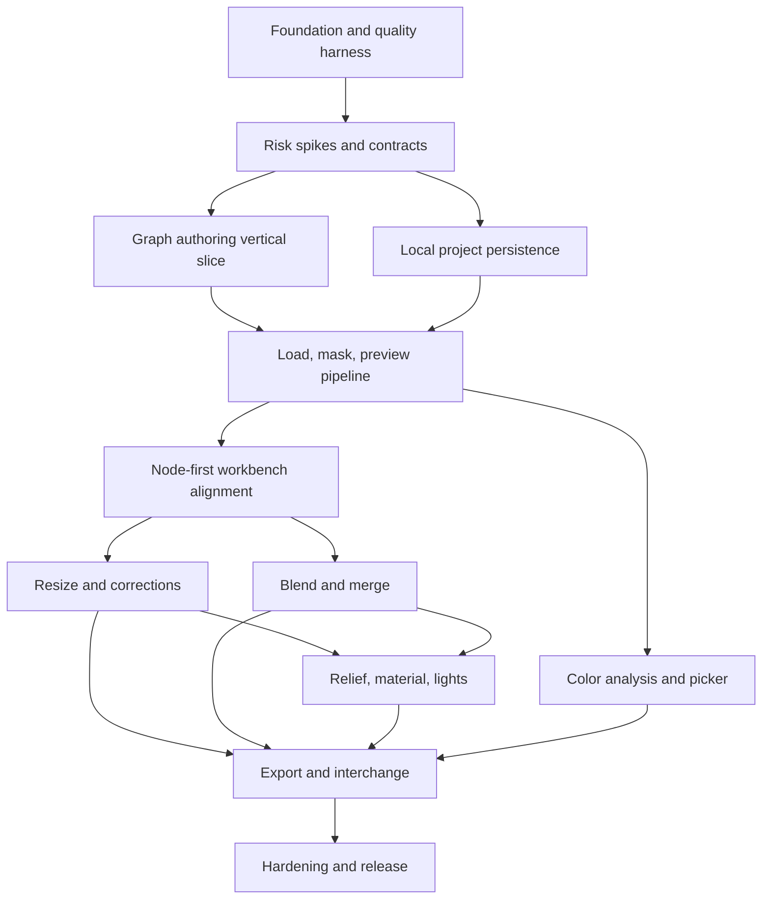

# Implementation Plan

## 1. Purpose

This is the dependency-ordered plan for building the specified product. It is
distinct from the detailing plan: the detailing plan defined how to create and
evaluate the specifications; this plan turns the closed contracts into tested
vertical product increments.

No calendar estimates or team size are assumed. Milestones are outcome gates,
not time boxes. A milestone closes only with its objective evidence.

## 2. Delivery Principles

- Retire semantic, codec, memory, and persistence risks before multiplying UI.
- Build vertical slices that include UI, domain, compute, persistence, and tests.
- Keep TypeScript scalar kernels as an independent oracle; optimize only measured
  workloads and never replace the oracle with the optimization.
- Keep image compute, storage, and graph rendering separate from the first slice.
- Add each named algorithm with discriminating fixtures, not a shared placeholder.
- Treat nodes as the primary operational surface: common widgets and output
  previews live in nodes; inspector fields are schema-driven mirrors/details.
- Separate authored edits/drafts from explicit workflow runs, partial runs, queue
  records, and current completed results.
- Schema and algorithm versioning begin with the first saved fixture, not at release.
- Reopen the smallest milestone/work package that fails a higher-level gate.
- Do not close or commit an implementation milestone until Playwright opens the
  actual app in a real target browser and proves the user can complete the
  milestone's intended task with the expected visible experience.

## 3. Planned Repository Shape

```text
/
  app/
    src/
      app/                 composition root, routing, error boundaries
      components/          shared design-system components
      features/            projects, graph, inspector, preview, export
      domain/              commands, authored model, graph rules
      processing/          contracts, registry, scalar reference
      workers/             scheduler, compute and persistence clients
      storage/             repository interfaces and Dexie adapter
      workflow/            schema, canonical JSON, migrations, PNG envelope
      testing/             fixture and capture adapters
    public/
    tests/
  crates/
    image-kernels/         Rust/WASM production CPU kernels
  fixtures/
    images/
    workflows/
    vectors/
    artifacts/
  schemas/
  documentation/
```

`app/package-lock.json` is the single JavaScript dependency lockfile. The
repository-root `.npmrc` controls its managed registry. Rust is pinned by
toolchain file and Cargo.lock. Generated WASM/artifacts are build output, not
hand-edited source.

## 4. Milestone Graph



## 5. Milestones

### Mandatory milestone UX evaluation

Every milestone M0 through M10 ends with a Playwright UX evaluation against a
Playwright-owned actual app instance. The scenario must express the user goal,
open the app in a real target browser, perform the task with real input, and
judge visible paint, geometry, clipping, hit testing, focus, feedback, recovery,
and final outcome with retained screenshots/state evidence. Milestones that add
canvas or image output also inspect real painted pixels or semantic image values.

Functional tests, typecheck, lint, build, and numeric conformance remain required
supporting checks, but a passing engineering suite without a passing user-task
Playwright evaluation leaves the milestone in progress.

### M0: Foundation and quality harness

**Outcome:** A reproducible local project builds, tests, and runs an accessible
empty tool shell with enforceable module boundaries.

**Work packages**

- M0.1 Scaffold Vite React TypeScript, strict compiler/lint/format settings, and
  local scripts for build, unit, E2E, and artifact checks.
- M0.2 Establish root folders, import boundaries, environment validation, error
  boundary, and typed result/diagnostic primitives.
- M0.3 Install React Flow, Zustand, Ajv, Dexie, test tools, Playwright, and axe;
  pin versions and generate initial license/SBOM report.
- M0.4 Implement design token foundation, light/dark/system/forced-color shell,
  app regions, F6 navigation, and shared button/input/status primitives.
- M0.5 Establish fixture manifest with SHA-256/provenance and raw capture format.
- M0.6 Add CI-equivalent local aggregate command; do not require remote runners.

**Exit evidence**

- Clean install/build/typecheck/unit/E2E locally from repository instructions.
- Playwright opens the actual app and proves a first-time user can orient in the
  empty workspace, browse a node template, see the corresponding inspector state,
  change theme, and move among regions by keyboard without clipped, overlapping,
  or non-hit-testable UI; screenshot evidence is retained and axe has no
  violations.
- Dependency/license report has no blocking finding.
- Module-boundary test prevents UI importing IndexedDB or kernel internals.

### M1: Risk spikes and frozen contracts

**Outcome:** The highest-risk architecture choices have executable evidence and
accepted ADRs before feature scale-up.

**Work packages**

- M1.1 Implement scalar reference vectors for color conversion, alpha,
  compositing, resize core, normals, lighting, and representative color.
- M1.2 Prototype Rust/WASM tile kernel and transferable worker protocol; benchmark
  scalar versus WASM on small/standard fixtures.
- M1.3 Execute TIFF codec, color-import, PNG-envelope, large-workflow, normal
  suggestion, and WebGPU parity spikes from the research dossier.
- M1.4 Prototype IndexedDB snapshot/asset transaction, quota injection, and
  BroadcastChannel lease race.
- M1.5 Record ADRs and update only dependent contracts if evidence falsifies an
  assumption.

**Exit evidence**

- Every spike has commands, raw results, pass/fail, decision, fallback, and ADR.
- WASM and any accepted WebGPU prototype pass reference vectors.
- Selected TIFF/color/PNG approaches independently round-trip fixtures.
- Standard workload has a credible bounded memory/latency path.

### M2: Graph authoring vertical slice

**Outcome:** Users can create and edit a typed, accessible DAG independent of
image processing.

**Work packages**

- M2.1 Implement canonical node/edge models, type registry, handle cardinality,
  cycle prevention, diagnostics, and React Flow adapter.
- M2.2 Implement command model, undo/redo, selection, move, resize, duplicate,
  delete, z-order, bypass/mute/lock, and history coalescing.
- M2.3 Build node shell, ports/edges, library/search, inspector, minimap, toolbar,
  graph outline, and state matrix.
- M2.4 Implement graph composite keyboard model, Connect/Add/Position/Size
  dialogs, region navigation, command alternatives, shortcut remapping.
- M2.5 Add serializer round-trip for graph-only workflow v1.

**Exit evidence**

- Property tests reject cycles/cardinality/type failures and preserve valid DAGs.
- 300-node visual stress fixture meets graph interaction budget with no compute.
- Keyboard-only users add/connect/move/resize/lock/delete/undo.
- Graph state round-trips exactly through schema validation.

### M3: Local project persistence

**Outcome:** Authored graph projects autosave transactionally and recover from
interruption, quota errors, migration, and tab conflicts.

**Work packages**

- M3.1 Implement persistence worker, IndexedDB v1 stores/repositories, snapshot
  checksums, content-addressed assets, settings, and reclaimable preview cache.
- M3.2 Implement autosave state machine, explicit save, durability/persistence
  request, quota estimate/reclamation, project browser, and storage meter.
- M3.3 Implement checkpoint recovery, prior-valid snapshot fallback, trash/delete,
  and database/workflow migrations.
- M3.4 Implement multi-tab lease, read-only state, takeover, base-revision compare,
  and conflict recovery.

**Exit evidence**

- Fault injection at every transaction boundary yields old or new complete state.
- Quota and lease-race tests preserve current/previous authored revisions.
- Reload restores graph bounds/z-order/viewport/states exactly.
- UI never reports “saved” before the matching transaction completes.

### M4: Load, mask, and preview pipeline

**Outcome:** Users can safely import images, extract all required masks, connect a
preview, and see deterministic off-main-thread pixels.

**Work packages**

- M4.1 Implement bounded file sniffing, signature/dimension/profile/orientation
  normalization, batch report, asset deduplication, and object URL ownership.
- M4.2 Implement scheduler generations, dirty propagation, memory cache identity,
  CPU pool, cancellation, tile reservations, and progress messages.
- M4.3 Implement Load Image Color/Mask modes and luminosity/alpha/R/G/B extraction
  in scalar and WASM backends.
- M4.4 Implement Image Preview node/surface, checkerboard, mask modes, fit/100%,
  pixel inspection, stale/refinement behavior, and actual-pixel capture.
- M4.5 Connect imported assets to transactional project storage and relink errors.

**Exit evidence**

- All import/alpha/channel/orientation/profile fixtures meet processing oracles.
- Malformed/oversized files fail within budgets while batch continues.
- Stale result race and cancellation tests publish only newest generation.
- UI remains within graph/input budgets during standard preview evaluation.

### R1: Node-first workbench alignment

**Outcome:** The graph becomes a ComfyUI-informed operational workbench: common
controls and results live in nodes, inspector is secondary, and workflow/branch
execution is explicit, queued, observable, cancelable, and stale-safe.

This milestone is a material amendment dated 2026-08-15. M2 graph-domain and M4
processing evidence remain closed; only their presentation/execution layers
reopen. M5 numerical and worker work may continue in isolation, but M5 user-facing
closure is blocked until R1 passes.

**Work packages**

- R1.1 Define versioned node widget schemas and shared node/inspector renderers;
  migrate Load Image, Resize, Color Correction, Brightness, and Preview common
  fields into nodes without duplicate defaults or validation.
- R1.2 Add node-local source thumbnails/results, stable empty/loading/stale/
  running/cached/error/OOM geometry, collapse/expand, zoom-level detail policy,
  no-drag widget behavior, and selected-node toolbox.
- R1.3 Implement Run workflow, Run selected output, Interrupt, immutable run
  snapshots, ordered queue/history, node execution events/progress, demanded
  subgraphs, cache-hit/skipped states, and stale completion rejection.
- R1.4 Keep inspector as optional advanced/detail/multi-edit surface and prove
  field parity, focus restoration, undo coalescing, and serialization parity.
- R1.5 Re-run accessibility and performance with DOM widgets and bitmaps inside
  nodes at realistic 25-node and stress 100/300-node tiers.
- R1.6 Unify node insertion: draggable library templates, `/` and `Shift+A`
  searchable keyboard/pointer chooser at viewport center, and empty-canvas
  double-click chooser at the clicked graph coordinate.
- R1.7 Rebuild node chrome, title dragging, four-corner resizing, typed sockets,
  links, selected toolbox, rename, and collapse to the ComfyUI interaction model.
- R1.8 Generate typed optional `parameter:<key>` inputs for every editable widget
  and show shared node/inspector externally-driven state without losing fallback.
- R1.9 Add effective-parameter resolution and primitive number/string/boolean/
  color value nodes so every P0 widget type can be driven through execution.
- R1.10 Add connected-input detach/reconnect, empty-link compatible-node search,
  compatible target highlighting, serialization, undo, and Edge E2E evidence.
- R1.11 Remove socket clipping and split transient live drag position from the
  single authored move commit, including edge/minimap tracking and undo evidence.
- R1.12 Add ComfyUI-style Load Image browse/replace, node drop, clipboard paste,
  source thumbnail/metadata, shared validation/persistence, and recovery states.

**Exit evidence**

- With inspector closed, pointer and keyboard users import, add/configure nodes,
  connect, run, inspect in-node pixels, correct an error, and save.
- Full run and selected-output run produce objective demanded-node event sets,
  queue records, visible node states, and correct result ownership.
- Interrupt and stale-run races cannot publish canceled/older output; cache reuse
  reports cached without kernel execution.
- Drag/drop, slash search, keyboard selection, and double-click search create one
  correctly centered node at their specified graph-space coordinates under
  non-default pan/zoom; cancel/outside-drop paths create no mutation.
- Node chrome and connection gestures meet the ComfyUI amendment; every editable
  field has a typed socket, external values drive output without overwriting the
  manual fallback, and disconnect restores that fallback through save/reload.
- Node widget interactions are hit-testable and do not move/pan nodes. Loading,
  result, cached, and error states preserve node/port geometry.
- Node and inspector hosts write the same authored keys/defaults/validation and
  one undo transaction; workflow round-trip is unchanged.
- Actual Edge Playwright evidence retains screenshots, node rectangles, pixel
  samples, queue capture, focus log, and accessibility output.
- Sockets remain fully painted and hit-testable outside the node border; nodes,
  links, and minimap track title drags continuously while one move commits.
- Browse, node drop, and clipboard paste all load/replace through the same asset
  boundary, show actual in-node source pixels/metadata, persist, reload, and fail
  without discarding the previous valid source.

### M5: Resize and correction nodes

**Outcome:** Users can perform all versioned resize methods and color/brightness
corrections with identity-safe defaults and backend parity.

**Current status:** Scalar references and initial transform-worker evidence exist;
user-facing controls implemented only in the inspector are provisional and must
move to shared node widgets through R1 before this milestone can close.

**Work packages**

- M5.1 Implement type-aware resize geometry, edge modes, presets, and catalog v1,
  one kernel at a time with discriminating fixtures.
- M5.2 Implement Color Correction ordered pipeline and common mask mixing.
- M5.3 Implement Brightness Correction formula and tonal-weight visualization in
  tests/diagnostics, not as a user-facing image unless designed.
- M5.4 Add tile halos, cache keys, schema-driven node controls with inspector
  mirrors, node-local draft/result state, explicit run progress, cancellation,
  and performance optimizations for these nodes.

**Exit evidence**

- Every catalog algorithm dispatches distinctly and passes no-op/alpha/normal/
  rings/tile-boundary fixtures.
- Neutral controls are identity; alpha is unchanged.
- WASM and accepted GPU implementations match scalar tolerances.
- Repeated standard slider workflow meets preview and memory budgets.
- Principal resize/correction workflow runs with inspector closed and displays the
  output in its Preview node; explicit Run/partial-run records the correct branch.

### M6: Blend and merge

**Outcome:** Users can combine two layers with complete standard and creative
catalogs, explicit ordering, opacity/mask, dimensions, and correct alpha.

**Work packages**

- M6.1 Implement W3C straight-color blend plus source-over compositing and all 16
  standard modes.
- M6.2 Implement creative extension catalog one formula at a time.
- M6.3 Implement Merge ports, foreground/background labels, Swap Layers, opacity,
  mask, center/max canvas, bypass/mute, node-local controls/result preview, and
  serialization.
- M6.4 Add layer/dimension/transparent-edge UX and full fixture matrix.

**Exit evidence**

- Every mode passes scalar/alpha/golden tests and semantic distinctness gate.
- Layer swap changes asymmetric fixtures and UI/serialized labels consistently.
- Transparent RGB and mismatched extent cases do not produce fringes/leaks.
- Standard merge workflow meets repeated interaction budgets.

### M7: Relief, material, and lights

**Outcome:** Normal, height, bump/displacement/roughness, arbitrary images, and
multiple parallel lights produce the specified 2D shaded material/merge output.

**Work packages**

- M7.1 Implement normal decode/swizzle/flip/reconstruct/normalize and suggestion
  with manual override.
- M7.2 Implement luminance/channel height, invert, central gradient, strength,
  type-aware resizing, and arbitrary-image warning.
- M7.3 Implement Light value/node, direction control/numeric input, tint/mix,
  intensity, mute, node-local widgets, and deterministic variadic ordering.
- M7.4 Implement Material base color/image, opacity, one relief source, implicit
  default light/materialization, explicit-light/all-muted rules, and shading.
- M7.5 Implement Merge relief modifier using the same canonical converters/shader.

**Exit evidence**

- Convention flips and light directions match normal/sphere/height pixel oracles.
- Flat normal, zero strength, opacity, no-light/default/all-muted rules pass.
- Arbitrary input remains accepted, bounded, warned, and reproducible.
- No 3D surface or hidden graph-wide light dependency appears in code/UI/schema.

### M8: Representative color and HSL picker

**Outcome:** Users can pick colors consistently and objectively compare a texture
representative color with a target.

**Work packages**

- M8.1 Implement shared color model/parser/serializer and accessible picker
  behavior using provisional tokens.
- M8.2 Map visual tokens/layout/states to approved design source when supplied;
  capture visual parity internally without exposing design-source metadata.
- M8.3 Implement deterministic alpha-weighted reduction, HSL/hex display,
  shortest signed deltas, CIEDE2000, transparent absence, and target compare.
- M8.4 Use the picker in Material, Light, Color Correction, target, JPEG background,
  and all future color fields; prohibit duplicate picker implementations.
- M8.5 Render ordinary picker hosts in nodes first and mirror the same component in
  inspector/details; analysis swatches and comparison results render in-node.

**Exit evidence**

- Picker keyboard/direct-entry/validation/undo and WCAG checks pass in all hosts.
- One component/source appears across every color field.
- Representative color and Delta E match numeric references.
- Exact visual parity is claimed only after source-based screenshot/state review.

### M9: Export and interchange

**Outcome:** Users can produce valid PNG/JPEG/TIFF, portable workflow JSON, and
restore valid workflow metadata from PNG without risking pixel import.

**Work packages**

- M9.1 Implement full-resolution export coordinator, memory preflight, progress,
  cancellation, temporary artifact lifecycle, and deterministic quantization.
- M9.1A Integrate export as an explicit run target with queue/history and node-local
  progress/result state; draft preview completion never counts as export run.
- M9.2 Implement PNG/JPEG adapters, alpha/background/profile/quality policies,
  EXIF stripping, and independent decode tests.
- M9.3 Integrate selected TIFF adapter and only expose capabilities proven by
  SPIKE-001.
- M9.4 Implement canonical JSON export/import report, missing asset relink, future
  read-only behavior, and sequential migrations.
- M9.5 Implement bounded PNG iTXt envelope writer/reader, CRC/SHA/size/ratio/schema
  checks, stripping/corruption fallback, and opt-in UI.

**Exit evidence**

- E2E-010/011 pass in target browsers and two independent artifact decoders.
- Cancel/OOM/quota leave no partial artifact and preserve project state.
- Metadata absent/corrupt/oversized never prevents pixel import.
- Export contains no unselected EXIF/private metadata; workflow opt-in is visible.

### M10: Hardening and release

**Outcome:** The integrated P0 product passes realistic correctness,
accessibility, security, compatibility, performance, recovery, and traceability
gates.

**Work packages**

- M10.1 Run complete fixture, browser, backend, workload, recovery, migration,
  multi-tab, and export suites; repair smallest failing slice.
- M10.2 Complete manual keyboard/screen-reader/forced-color/reduced-motion review
  and responsive text/overlap/hit-test screenshot review.
- M10.3 Fuzz parsers, audit CSP/network/object URLs/service worker/dependencies,
  generate final SBOM/license report, and resolve critical/high findings.
- M10.4 Profile five-minute standard/large workflows, memory release, startup,
  autosave/export contention; correct architecture rather than masking budgets.
- M10.5 Complete requirement traceability, user documentation, recovery/export
  guidance, supported browser/format matrix, and release checklist.

**Exit evidence**

- Every gate in the quality strategy passes with retained evidence.
- No P0 requirement/test/milestone/source statement is orphaned.
- Blocking open questions are resolved; accepted residual risks have owner and
  user-visible behavior.
- Clean production build can be served statically over required HTTPS headers.

## 6. Parallel Work

After M1 closes:

- M2 graph UI and M3 persistence may proceed in parallel against frozen domain
  and workflow contracts.
- Within M4, import/codec normalization, scheduler, and preview components may
  proceed in parallel after message/data types freeze.
- M5, M6, and M8 may proceed in parallel after M4, but share kernel registry,
  fixture, and design-system review checkpoints.
- M7 depends on resize semantics and benefits from blend completion; M9 integrates
  all processing outputs and cannot close early.
- No downstream user-facing node milestone can close before R1. Mathematical,
  codec, or worker tasks may proceed in isolation but retain provisional UX status.

Integration occurs continuously through vertical fixtures. No branch may defer
schema, worker, accessibility, or tests to a final merge phase.

## 7. Work Item Definition of Ready

A work item is ready when it has requirement IDs, observable outcome, inputs and
dependencies, API/schema impact, normal/invalid/cancel behavior, objective test,
performance/memory implications, and design/accessibility states. Algorithm work
also requires formula/version/fixture/tolerance.

## 8. Work Item Definition of Done

A work item is done when code and schema/docs agree; unit/conformance/integration
tests pass; applicable pointer/keyboard/visual/error states are implemented;
captured evidence proves the semantic claim; performance/security impact is
checked; Playwright proves the intended user task works in the actual app; no
stale result/resource leak remains; and traceability is updated.

## 9. Project Completion

Completing all tasks does not automatically complete the project. M10 reevaluates
the product-level definition of done. A failed project gate identifies the
smallest responsible milestone/work package, reopens it, preserves passing
evidence elsewhere, and reruns both its local gate and affected project gates.