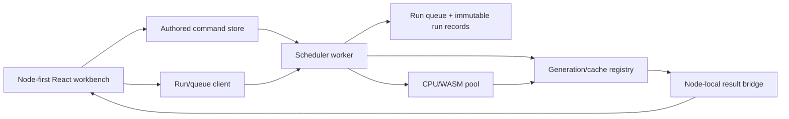
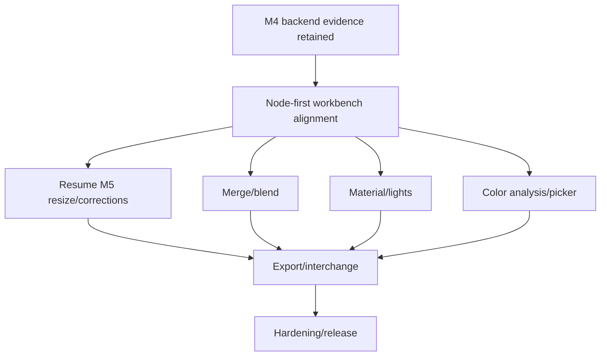

# Node-First Workbench Contract Update

## 1. Status and authority

This document records the user-directed product update dated 2026-08-15. It is a
material amendment to the derived product, UX, architecture, quality, and
implementation specifications. The immutable `seed-spec.md` remains unchanged.
Where an older derived document says the inspector is the complete editing
surface or treats execution as implicit preview demand, this update takes
precedence.

Implementation milestone M5 is paused at a reviewable numerical/worker boundary.
The graph domain, persistence worker, image import, scalar oracles, and preview
worker evidence remain valid. Node presentation and workflow execution UX reopen
through the smallest capable workstream defined below.

## 2. Updated product outcome

Build a node-first visual image workbench in which the canvas is the place users
both understand and operate the workflow:

- Common parameters are edited directly inside their owning nodes.
- Image-producing and analysis nodes show their result directly inside the node.
- The inspector remains available for advanced parameters, validation detail,
  metadata, documentation, and multi-selection editing; it is not required for
  ordinary node operation.
- A visible Run workflow command executes the graph intentionally. Selected output
  nodes support partial execution of only their required upstream branch.
- Execution queue/history, running/error/cached states, and cancellation are
  visible and recoverable without hiding authored state.
- Node management follows familiar ComfyUI interaction principles while retaining
  this product's visual language, typed contracts, local-first processing,
  accessibility requirements, and deterministic image math.

The goal is behavioral familiarity, not visual cloning or adoption of ComfyUI's
AI-generation domain.

## 3. Reference evidence and extracted principles

Official ComfyUI documentation was reviewed from:

- `https://docs.comfy.org/interface/overview.md`
- `https://docs.comfy.org/basic-concepts/nodes.md`
- `https://docs.comfy.org/basic-concepts/properties.md`
- `https://docs.comfy.org/basic-concepts/workflow.md`
- `https://docs.comfy.org/interface/features/partial-execution.md`
- `https://docs.comfy.org/interface/shortcuts.md`
- `https://docs.comfy.org/interface/nodes-2.md`
- `https://docs.comfy.org/get_started/first_generation.md`

The relevant principles are:

1. Nodes are functional operators with inputs, outputs, and editable properties.
2. Properties are normally edited as widgets directly on the node and may also be
   driven by typed input connections.
3. Output results appear in output nodes, making execution legible on the canvas.
4. Nodes expose normal, running, error, missing, bypass, and non-executing states.
5. Node selection provides nearby management commands; context menus provide the
   complete node command set.
6. The top control area owns Run and queue management. `Ctrl+Enter` runs/queues the
   workflow; interruption is a separate command.
7. Partial execution is an explicit action on a selected output node and evaluates
   only that output's required upstream branch.
8. Node/workflow/queue side panels support navigation and management. They do not
   replace direct node property editing.
9. Rich DOM-backed widgets, expandable nodes, and node-local components require
   explicit large-graph performance evaluation.

## 4. Experience contract

### 4.1 Canvas and panels

The graph canvas remains primary. The left panel hosts node search/templates. The
right inspector is secondary and optional during normal composition. The queue and
run history use a right-side panel or drawer that can coexist with or replace the
inspector.

A user must be able to create, configure, run, inspect, and correct the principal
workflow without opening the inspector.

### 4.2 Node-local widgets

Each node type declares a versioned widget schema. Widgets render from the same
parameter schema used by the inspector and workflow serializer.

- Load Image: source name/replace command, output mode, mask source, invert, compact
  source metadata, and source thumbnail.
- Resize: width/height, units, aspect lock, preset, resolved algorithm, reset.
- Color Correction: compact hue/saturation/temperature/green-magenta/tint controls
  with direct numeric entry and reset.
- Brightness: exposure/highlights/shadows/whites/blacks with direct numeric entry
  and reset.
- Preview: node-local result bitmap, fit/100% mode, interpretation and dimensions.
- Future Material/Merge/Light/Color Analysis nodes: their high-frequency P0
  controls and output previews or swatches live in the node.

The inspector renders the same fields at larger scale, plus advanced options,
validation details, metadata, keyboard help, and multi-selection edits. It must
not implement a second parameter definition or different defaults.

Widget interactions carry a `nodrag`/no-pan contract so sliders, selects, text,
scrolling, and pointer preview actions do not move the node. Continuous widget
edits preview continuously but coalesce into one undo command at commit.

### 4.3 Node-local previews

Preview-producing nodes reserve stable aspect-ratio space. Existing results remain
visible while stale, with an updating state. Running, canceled, error, empty, OOM,
and cached states use the same dimensions and cannot resize surrounding graph
layout.

At distant zoom or collapsed state, expensive widgets and bitmaps may be hidden,
but title, state, ports, and a compact result indicator remain available. Opening
or zooming restores the live node content without changing authored values.

### 4.4 Node management

Selected nodes expose a nearby toolbox for run-partial (output nodes), bypass,
mute, lock, duplicate, and delete. The existing context menu remains the complete
keyboard/pointer command surface. Nodes support collapse/expand, corner resize,
title rename, and readable state badges. Inspector commands are alternatives, not
requirements.

### 4.5 Explicit workflow execution

Authoring and execution are separate systems:

- Editing parameters marks the node and affected downstream branch dirty/stale.
- Editing may compute a bounded local draft for immediate feedback, but it does
  not create a completed workflow run or queue record.
- Run workflow (`Ctrl+Enter`) validates the complete demanded output set, captures
  one immutable project revision, and enqueues a run.
- Run selected output executes only the required upstream subgraph for that output.
- Interrupt cancels queued/running generations and retains the latest valid result.
- Identical clean nodes reuse cache and visibly report cached/skipped status.
- Runs are ordered records with run ID, captured revision, target outputs, queued/
  running/succeeded/failed/canceled state, timestamps, node progress, diagnostics,
  and result references.
- A completed result may never be labeled current when its captured revision is
  older than the authored project revision.

## 5. Architecture amendment

Add these ownership boundaries:

- `node-widget-schema`: single source for node-local and inspector fields,
  validation, units, defaults, compact/advanced placement, and serialization keys.
- `run-queue`: ephemeral ordered run records with bounded retained history;
  workflow JSON stores execution settings but not transient queue entries.
- `scheduler-worker`: validates run snapshots, computes demanded output subgraphs,
  publishes node execution events, and rejects stale completion by run/revision/
  node generation.
- `result-registry`: owns the current and previous node-local bitmap/result handles
  and releases replaced resources.

No React component may contain unique processing math, cache rules, or parameter
defaults.

## 6. Reopened implementation graph

M2 graph-domain and M4 processing evidence remain closed. Their presentation
layers reopen only inside R1.

### R1 work packages

- R1.1 Define shared node widget schemas and migrate Load Image, Resize, Color
  Correction, Brightness, and Preview ordinary controls into nodes.
- R1.2 Add node-local source/result previews, stable stale/running/error/cached
  states, collapse/expand, and zoom-level detail policy.
- R1.3 Add Run workflow, Run selected output, Interrupt, queue/history panel, run
  records, node progress, cache-hit/skipped state, and stale-revision rejection.
- R1.4 Make inspector schema-driven and secondary; remove duplicate private field
  definitions and prove parity between node and inspector edits.
- R1.5 Re-run graph accessibility/performance gates with interactive DOM widgets
  and node-local bitmaps at 25/100/300 node tiers.

### R1 exit evidence

- A pointer and keyboard user completes import → configure inside nodes → connect →
  Run → inspect node-local output without opening the inspector.
- Node-local and inspector edits update the same authored field and undo history.
- Run and partial-run produce explicit queue records and correct demanded subgraphs;
  interrupt and stale completion cannot publish current output.
- Preview nodes show real nonblank pixels in-node with stable geometry through
  loading/error/cached states.
- Widget hit testing never drags/pans nodes; focus order and screen-reader names are
  valid at 100% and 200% zoom.
- The 300-node stress workflow remains within graph response budgets under the
  compact detail policy; a realistic 25-node workflow with expanded controls and
  previews remains readable and responsive.
- Playwright owns the actual Edge app and retains screenshots, pixel samples,
  queue capture, focus logs, geometry, overlap, hit-test, and recovery evidence.

## 7. Impact on current implementation

Keep:

- Typed graph/domain commands and workflow schema.
- Persistence worker, assets, snapshots, leases, and viewport restoration.
- Scalar/WASM oracles, image sniffing, image preview worker, cache identities,
  generations, and M5 transform operation contracts.
- Existing inspector controls temporarily as fallback during migration.

Rework:

- `WorkflowNode` becomes a schema-driven interactive node shell.
- `ImagePreviewCanvas` moves into Preview nodes; the inspector may mirror or enlarge
  the same result.
- Load/Resize/Color/Brightness ordinary fields move from `App.tsx` inspector markup
  into shared node widget components.
- Automatic preview demand becomes explicitly distinguishable from workflow Run.
- Toolbar gains Run/Interrupt and queue status; status/side panel gains run history.

Delete after parity evidence:

- Duplicate inspector-only parameter definitions.
- Any preview surface that is the sole way to inspect a node result.
- Any UI path that marks a workflow run complete merely because a draft preview
  resolved.

## 8. Project-level definition of done amendment

The project cannot close unless every P0 node is operable on-canvas, every output
is inspectable in its node, the full workflow and selected-output branches can be
run explicitly, queue/cancel/cache/stale behavior is visible and correct, and the
inspector is optional for the principal composition workflow. Passing pixel math
or an inspector-only flow is insufficient.
